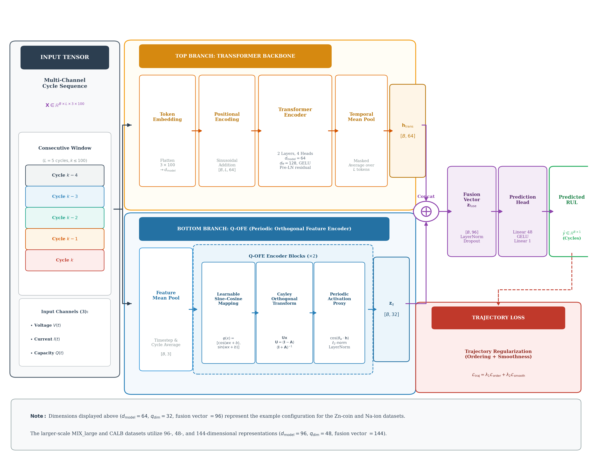
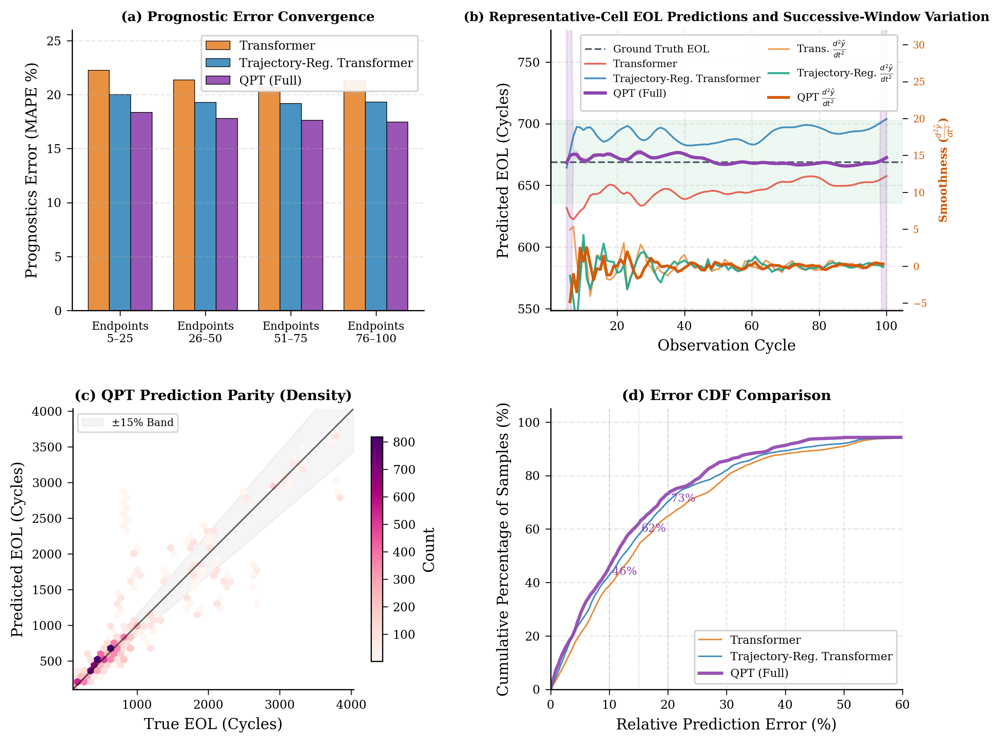
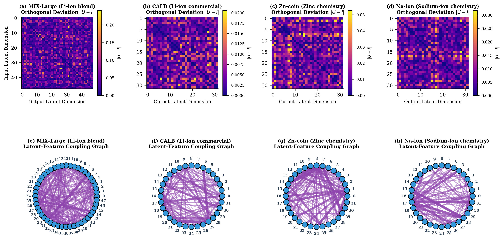
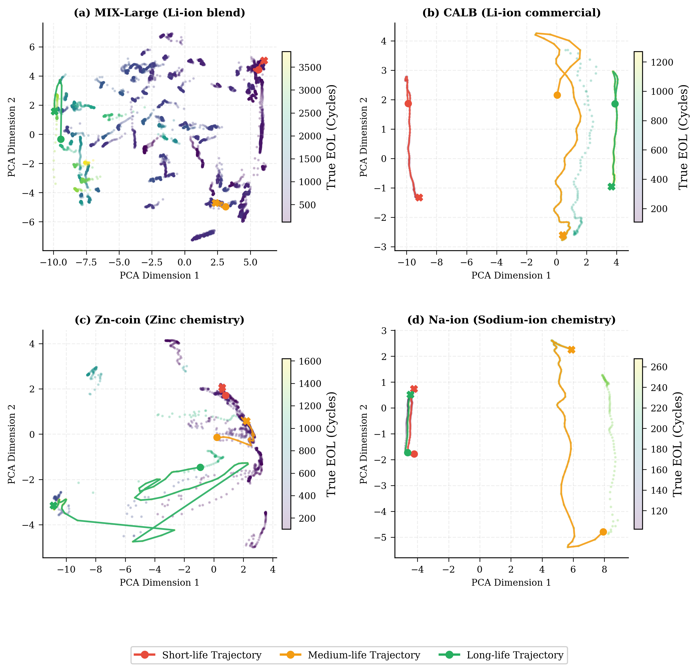
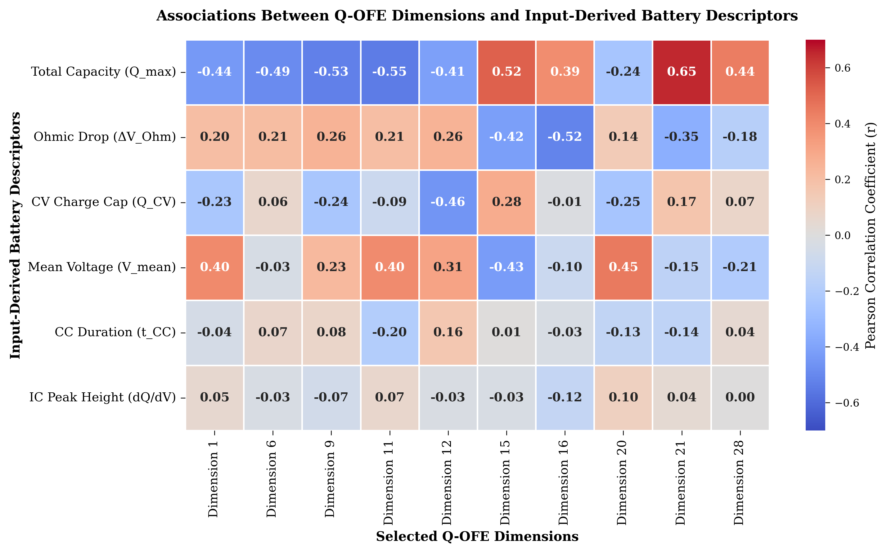

# Physics-Informed Quantum-Inspired Transformer (QPT)

[](https://opensource.org/licenses/MIT)
[](https://www.python.org/)
[](https://pytorch.org/)
[]()

Official repository for the paper:  
**"Physics-Informed Quantum-Inspired Transformer for Multi-Channel Battery State of Health and Remaining Useful Life Prediction"**

---

## 📢 Code Availability Notice

> **Note on Source Code & Pretrained Checkpoints:**  
> The complete source code, training/evaluation pipelines, preprocessing scripts, and trained model weights are currently undergoing peer review alongside our submitted manuscript.  
> **The entire codebase and checkpoint artifacts will be publicly uploaded to this repository immediately upon formal acceptance of the manuscript.**  
> For any questions or pre-print inquiries, please feel free to reach out via GitHub Issues or contact the authors.

---

## 📖 Overview

Accurately predicting battery State of Health (SOH) and Remaining Useful Life (RUL) from early operational cycles ($L \le 5$ cycles) is crucial for the safety and reliability of electric vehicles (EVs) and energy storage systems (BMS). Conventional deep learning architectures (e.g., LSTMs, vanilla Transformers) often overfit early-life cyclic noise and produce physically impossible predictions, such as spontaneous capacity regeneration.

To overcome these challenges, we propose the **Physics-Informed Quantum-Inspired Transformer (QPT)**:
1. **Differentiable Simulated Variational Quantum Circuit (VQC)**: Encodes multi-channel charging/discharging voltage, current, and capacity profiles into high-dimensional quantum Hilbert states via feature re-uploading and skew-symmetric Cayley unitary transformations ($U^T U = I$), guaranteeing exact norm preservation and mitigating gradient vanishing/explosion.
2. **Temporal Transformer Backbone**: Aggregates macro-cycle sequence dependencies across observation windows.
3. **Thermodynamic Loss Constraints**: Regulates learning dynamics by directly embedding electrochemical principles into the objective function:
   - **Monotonicity Loss ($\mathcal{L}_{\text{mono}}$)**: Penalizes unphysical capacity increases.
   - **Smoothness Loss ($\mathcal{L}_{\text{smooth}}$)**: Penalizes high-frequency non-physical prediction volatility.
   - **Capacity Consistency Loss ($\mathcal{L}_{\text{capacity}}$)**: Enforces bounds within real electrochemical operating limits.

---

## 🏛️ Architecture

<p align="center">
  
</p>

*Figure 1: Schematic diagram of the proposed Physics-Informed Quantum-Inspired Transformer (QPT) framework.*

---

## 📊 Key Results Across 4 Diverse Battery Chemistries

QPT was comprehensively benchmarked across four real-world battery datasets spanning multiple chemistries and form factors:
- **`MIX_large`**: Heterogeneous multi-chemistry Li-ion benchmark ($N=15,168$ cell cycles, NMC & LFP, 1C–8C fast charging).
- **`CALB`**: Commercial 72 Ah large-format LFP/graphite prismatic cells.
- **`ZN-coin`**: Aqueous Zinc-ion coin cells characterized by metallic zinc dendrite formation and erratic capacity swings.
- **`NAion`**: Commercial hard-carbon/P2-O3 Sodium-ion pouch cells in a small-sample regime.

### Quantitative Performance Comparison

| Dataset | Model | MAE (Cycles) $\downarrow$ | RMSE (Cycles) $\downarrow$ | MAPE $\downarrow$ | Acc@15% (%) $\uparrow$ | Acc@10% (%) $\uparrow$ |
| :--- | :--- | :---: | :---: | :---: | :---: | :---: |
| **`MIX_large`** | CPMLP Benchmark | — | — | 0.1790 | 62.0% | — |
| | CPTransformer Benchmark | — | — | 0.1840 | 57.3% | — |
| | LSTM Baseline | 204.2 | 413.0 | 0.2821 | 48.2% | 36.6% |
| | Transformer Baseline | 163.0 | 266.6 | 0.2136 | 53.9% | 38.8% |
| | Physics + Transformer | 160.7 | 288.3 | 0.1942 | 57.8% | 42.7% |
| | **QPT (Ours)** | **152.4** | **283.4** | **0.1778** | **62.0%** | **45.9%** |
| **`CALB`** | CPMLP Benchmark | — | — | 0.1400 | 70.4% | — |
| | CPTransformer Benchmark | — | — | 0.1490 | 67.2% | — |
| | LSTM Baseline | 294.3 | 423.5 | 0.5488 | 39.8% | 39.8% |
| | Transformer Baseline | 91.6 | 134.0 | 0.2021 | 59.1% | 57.4% |
| | Physics + Transformer | 97.2 | 115.8 | 0.2107 | 58.3% | 56.0% |
| | **QPT (Ours)** | **81.7** | **109.9** | **0.1373** | **59.5%** | **59.1%** |
| **`ZN-coin`** | CPMLP Benchmark | — | — | 0.5580 | 29.7% | — |
| | CPTransformer Benchmark | — | — | 0.5150 | 20.2% | — |
| | LSTM Baseline | 245.8 | 380.4 | 0.9015 | 3.8% | 3.8% |
| | Transformer Baseline | 152.0 | 280.5 | 0.5564 | 24.7% | 15.0% |
| | Physics + Transformer | 150.3 | 278.2 | 0.5505 | 27.7% | 16.5% |
| | **QPT (Ours)** | **169.0** | **316.3** | **0.4554** | **25.8%** | **19.3%** |
| **`NAion`** | CPMLP Benchmark | — | — | 0.2740 | 33.7% | — |
| | CPTransformer Benchmark | — | — | 0.2550 | 40.6% | — |
| | LSTM Baseline | 60.9 | 66.0 | 0.4194 | 40.0% | 0.0% |
| | Transformer Baseline | 56.6 | 64.1 | 0.3554 | 40.0% | 1.5% |
| | Physics + Transformer | 57.0 | 64.1 | 0.3624 | 40.0% | 1.5% |
| | **QPT (Ours)** | **45.3** | **61.4** | **0.2658** | **40.0%** | **40.0%** |

---

### Prognostic Trajectories and Error Convergence

<p align="center">
  
</p>

*Figure 2: EOL prediction performance and statistical error convergence analytics on the `MIX_large` test set: (a) dataset-wide error convergence across observation stages, (b) representative cycle-by-cycle trajectory prediction with $\pm 5\%$ confidence band, (c) True vs. Predicted parity hexbin density plot, and (d) relative prediction error CDF.*

---

### VQC Unitary Entanglement and Quantum Topologies

<p align="center">
  
</p>

*Figure 3: VQC Entanglement analysis across four benchmark datasets: (a–d) unitary deviation heatmaps $|U - I|$ for VQC Layer 2; (e–h) circular Virtual Qubit Entanglement Network Graphs showing learned quantum coupling topologies.*

---

### Latent Aging Manifold Projections

<p align="center">
  
</p>

*Figure 4: Latent representation PCA aging trajectory projections across all four battery chemistries, demonstrating smooth, continuous degradation manifolds.*

---

### Electrochemical Interpretability

<p align="center">
  
</p>

*Figure 5: Physical correlation analysis between virtual quantum qubit dimensions and electrochemical degradation indicators ($Q_{\text{max}}$ fade and Ohmic resistance expansion $\Delta V_{\text{Ohm}}$).*

---

## 📌 Citation

If you find this work or results useful in your research, please cite our paper:

```bibtex
@article{LeMinh2026QPT,
  title     = {Physics-Informed Quantum-Inspired Transformer for Multi-Channel Battery State of Health and Remaining Useful Life Prediction},
  author    = {Le Minh, Huy and Tan, Ruifeng},
  journal   = {Under Review},
  year      = {2026}
}
```

---

## 📜 License

This repository is licensed under the [MIT License](LICENSE).
